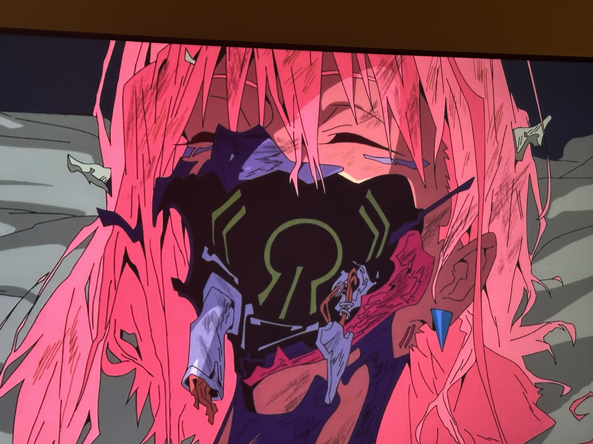

这个周末在家追完了《赛博朋克：边缘行者 2》，感觉整体的剧情质量严重下降。

感情线方面极其混乱，可能是塞的角色太多了，十集的剧情根本支撑不了给角色填充细腻的情感。当然了，也许是在夜之城根本没有人关心什么细腻的情感故事。

人物设定方面倒是搞得别出心裁。一个深爱着前女友，爱屋及乌能够心甘情愿献出生命保护前女友女儿的舔狗。一个冷酷无情，天生反派脸，为了公司利益连自己亲女儿都卖的爹（难怪能成为这个世界设定的高管呢）。还有喜欢年下幼童，还喜欢被拍短视频的女主。喜欢到摄影拿着录像机到处乱拍的幼童男主（私以为是男一，毕竟给了那么多镜头）。还有脑子被门夹了，错把 AI 当自己真有实力的男二（这倒是嘲讽了当今 Vibe Coding 现状）。以及若干不重要的配角们。每个人看起来都很有故事，但是一个都没讲……可能大家真的太忙了，没空照顾到所有人吧。

如果是 0—10 分的话，我感觉打个 3 分吧。纯纯情怀分，剧情结局已经没有看第一季的震撼了，而且大结局也搞得十分虎头蛇尾，搞得人云里雾里的，男二啪叽一下就挂了。另外，我看剧情一直穿插着幼童男主拍来拍去，我还以为最后会搞个片段剪辑版本，快速过一下所有的从第一集开始的所有故事线，让人回味一下，结果是啥也没有……画面切来切去拍了个寂寞……

总而言之，夜之城的故事还在继续，个人对抗资本总是无疾而终。城市里发生的各种各样破坏性的事件和动乱，老百姓的生命在大公司面前显得都不足为提。只要利益足够，发射导弹轰炸城市也没有关系。

