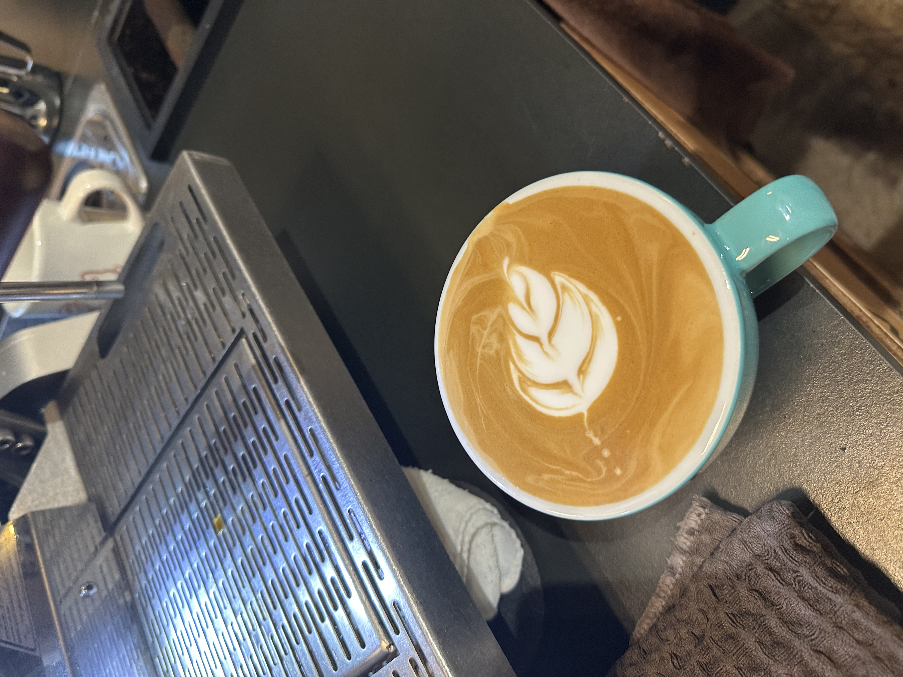
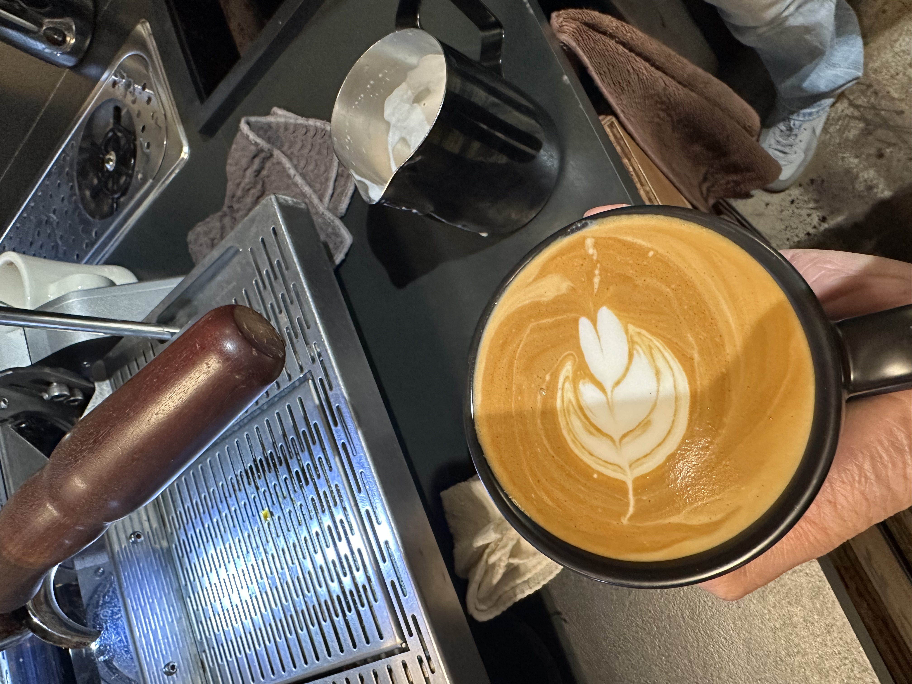
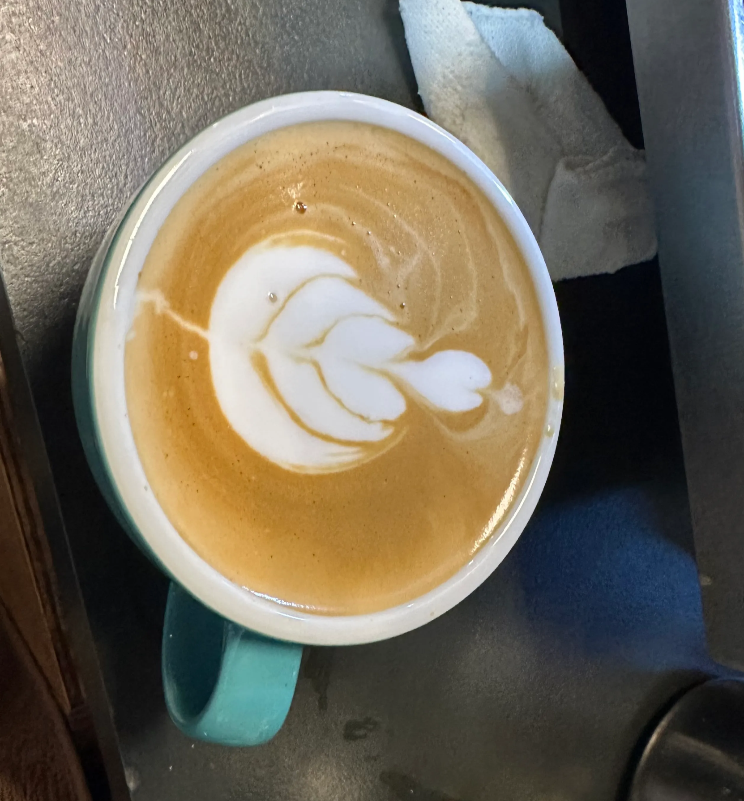
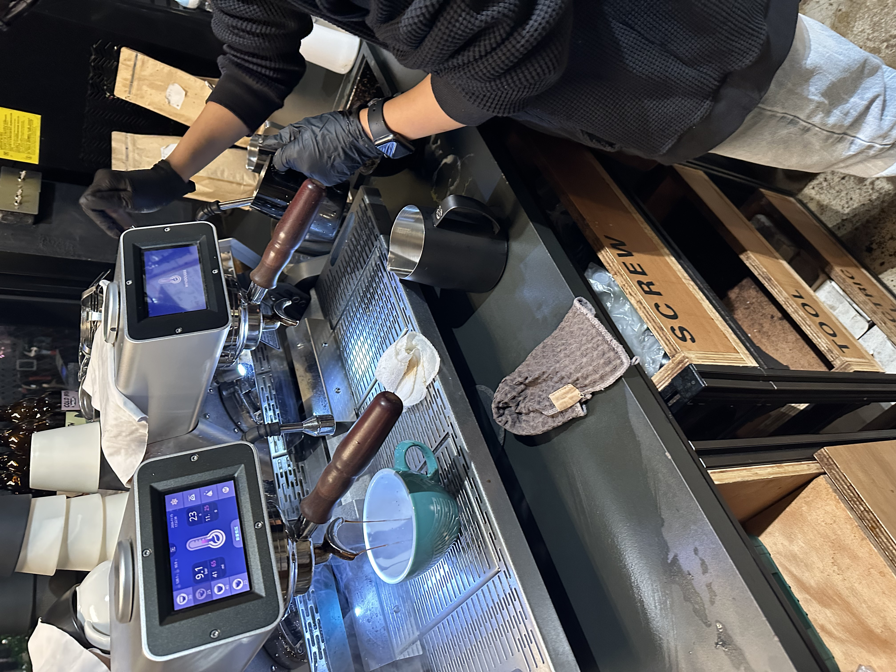
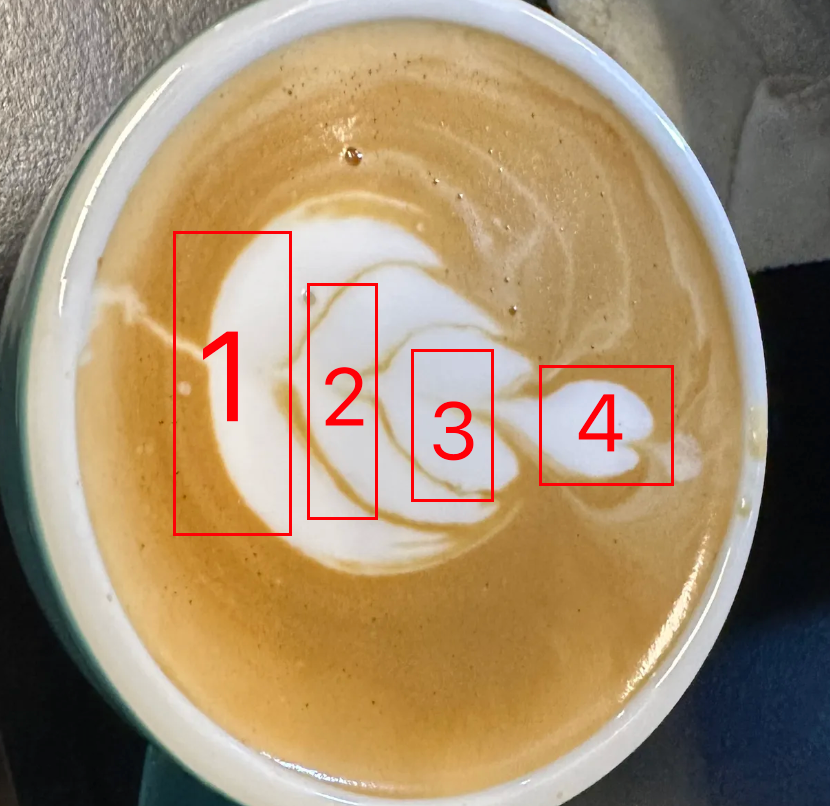
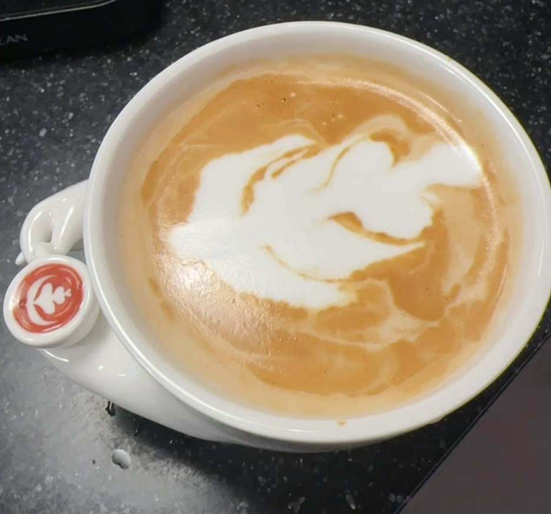

While taking a couple of days off back in my hometown, I picked up a few skills at the café downstairs where I often go. After some serious practice (meaning one hour a day), I finally went from pouring a blob to something at least presentable. Enough talking—here are the photos first (my teacher's work is on the right in photo 4):

Before I start, a little disclaimer: everything here comes from what I figured out through repeated experiments during those two hours. Some parts may not be entirely accurate, scientific, or professional. I only learned the stacked tulip, not the more complicated leaf patterns with fine lines.

## Milk

If you want to pour a flower rather than a blob, choosing the right milk matters. Whole milk is the best option: its high fat and protein content is key to creating fine, dense foam, and the fat gives it a silky mouthfeel. Barista oat milk is my second choice. A quick aside: now that I'm back in Finland, the Finnish whole milk feels a little too fatty, and I've found it hard to foam. Both of my attempts ended up as blobs. Oat milk has actually been a little easier.

## Steaming Milk

Steaming milk really is a skill in its own right. I spent quite a while practicing. From my experience, good steamed milk involves three stages: stretching, texturing, and finally polishing. As my teacher put it, the surface should look like wet paint: smooth and fine, without obvious bubbles.

So how do you get there? First, the steam wand's position: insert it in line with the pitcher spout, then move it toward the three o'clock position. This naturally creates a whirlpool. For depth, a useful approach reminds me of annealing in machine learning. Start with the wand about 2 cm below the surface, turn on the steam, and let the milk start swirling. Then raise the tip slightly until you hear a continuous hissing sound, which means air is going in. About four seconds of this worked well for me. After that, lower the tip again to mix the foam on top evenly into the milk. The shear from the swirling liquid also breaks large bubbles into fine, uniform microfoam (doesn't this feel like a fluid mechanics experiment?). As for how long to keep going, stop when the pitcher feels slightly hot, around 60°C. In my understanding, that temperature is about getting the best milk flavor rather than forming the foam itself.

Finally, if there are still bubbles on top after steaming, tap the pitcher a couple of times to pop the large ones. That makes pouring easier.

## Integration

Of course, before integrating the milk, you need to pull an espresso shot. I won't go into that here. The part before you start drawing the pattern is called integration. At first, we don't want any white foam appearing on top. The aim is to mix the espresso and milk as evenly as possible, leaving a uniform light-brown surface. To achieve this, pour the milk from a relatively high position. You can also pour in circles around the center of the cup to mix them more thoroughly. The idea is to give every part its fair share, blending the milk and espresso evenly together.

This gives you a nicer surface for the pattern and a more consistent taste throughout the drink.

How much should you pour? Here's a trick: tilt the cup to 45 degrees during integration and keep pouring until the liquid is almost spilling over at that angle. Why? Because that makes the final latte art stage easier.

## Latte Art

OK, we've finally reached the actual pouring of the pattern.

After practicing, I feel that choosing the milk, steaming it, and integrating it are actually more important. The final pattern may not be as complicated as people imagine—or at least not as complicated as I used to imagine (very intricate designs are another story, of course). You only need to remember one principle: what determines whether the white foam floats on the surface? The distance between the pitcher spout and the liquid's surface.

**Height controls whether the white foam appears!**

This is pretty intuitive. If the spout is farther from the surface, the stream hits harder and pushes the milk underneath, right? If the spout is closer, there's less impact, so the foam floats on top instead of mixing into the espresso.

Now that we know how to make the white appear, pouring a flower like the ones above becomes fairly straightforward. The pattern has four parts: three progressively smaller leaves and a final bud.

How do you do it? The method I learned is called “推推乐,” roughly “push-push,” a relatively simple stacked tulip. Essentially, you stack several shapes:

1. The first leaf (1), the bottom and largest one: Start pouring in the center. Since this first leaf will be the bottom and largest one, use a generous flow. It may not look like a leaf immediately after pouring.
2. The second (2) and third (3) leaves: Choose the next pouring point a little farther back and continue with a generous flow. You don't need to push forward. As you pour, the new shape squeezes into the previous one, revealing the previous leaf's shape. The third leaf works the same way. Since each leaf should be smaller, stop each pour a little sooner than the last.
3. The final bud (4) and stem: The most important part is finishing the bud. Start with a generous flow, then gradually reduce it while lifting the pitcher. Why lift it? Because you're finishing now and want as little extra white foam on top as possible. As you lift, use a medium flow and move quickly toward the first, largest leaf, cutting through and connecting all the leaves to form the flower's stem.

Despite the name “push-push,” you aren't actively pushing the pitcher forward as you pour. The spout already directs the stream downward and slightly forward, so the foam naturally spreads and presses forward without you moving your hand. That's the “push”: the new stream pushes the already formed foam outward.

One more trick: remember how we tilted the cup to 45 degrees? As you keep pouring, the liquid level rises, so gradually bring the cup upright at the same time. Why gradually rather than starting upright? Because you want the spout as close to the surface as possible, making it easier for the foam to appear, right?

All right, I think that covers everything I learned.

Really, getting the chance to learn this took a bit of persistence. A few months ago, I went back to China and visited this café downstairs from my home. The first time, I asked my teacher, “Coach, I want to learn latte art.” She wasn't particularly keen to teach me: she had her own work to do, and the café was genuinely busy. She said she'd have to ask the owner. I suspect she was worried the owner might mind, and the whole thing eventually went nowhere.

On this trip back, the owner happened to be in the café. I asked my teacher again, and she hinted, “See what the owner thinks.” So I went straight to the owner. I think a lot of things work this way: you need some persistence. The owner looked a little reluctant, but with me being so shamelessly persistent, it was hard to say no. I also pointed out that I really was a regular and had spent quite a bit on coffee there. Whatever the reason, they ended up letting me learn there for two days, and I did come away with something to show for it.

While learning, I kept asking my teacher about the principles and taking notes. That's how this post came about, and I wanted to share it with you. If I've got anything wrong, corrections are welcome. Let's keep making better latte art together~

Finally, here's my new cup (yes, I'm a gear person), along with the aforementioned blob 🤢.

