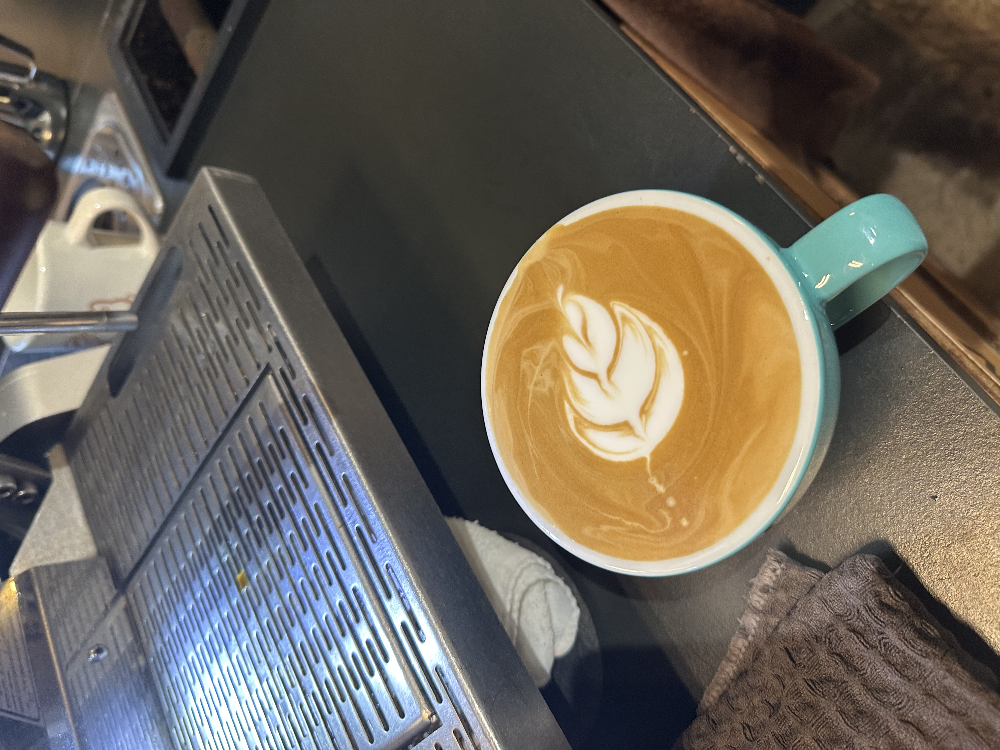
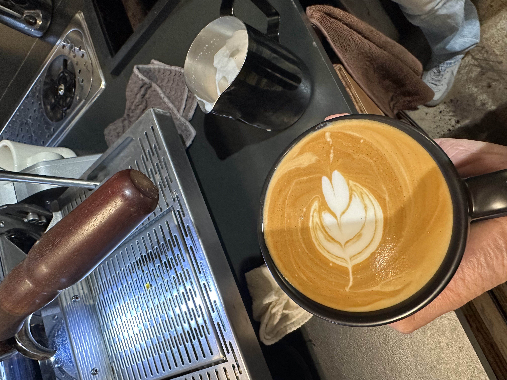
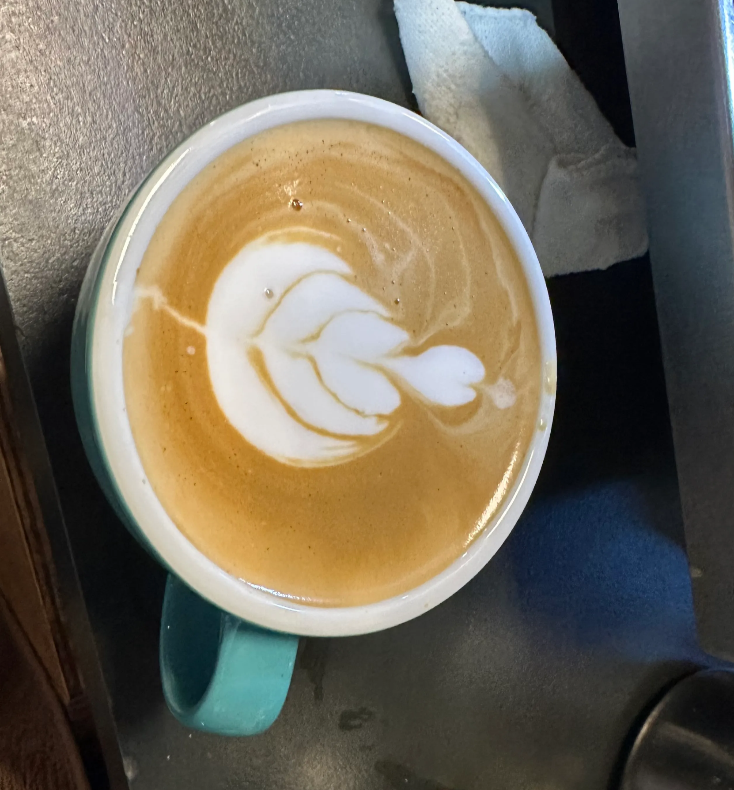
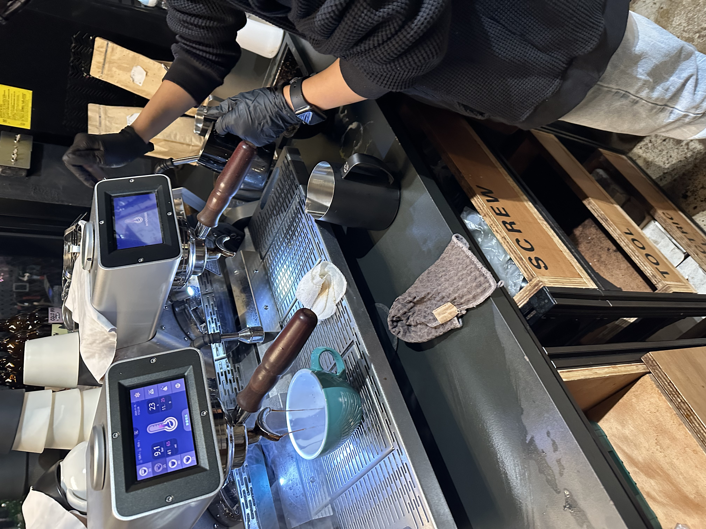
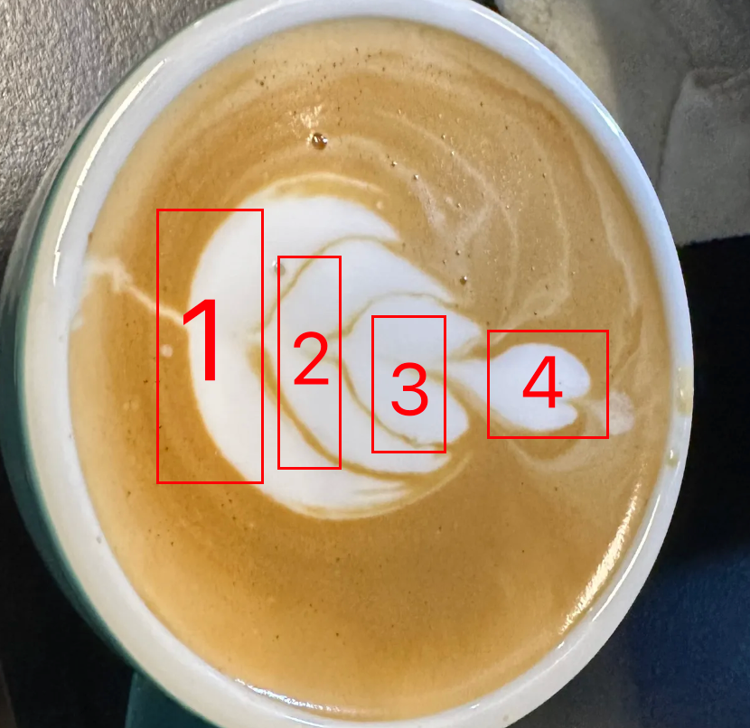
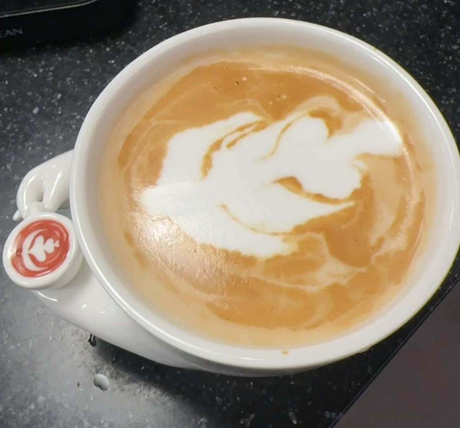

这两天回老家休息，就在楼下经常去的那家咖啡厅拜师学了一下艺。经过一些苦练（指每天 1 小时），终于也是从拉出一坨变成了好歹能看。话不多说，先上个图（图 4 右侧为师傅）：

在写之前我先叠个甲：所有的一切都基于我在这 2 小时过程中进行了多次实验得到的感悟，有些部分可能说得不是很准确/科学/专业。我只学习了推推乐，没有去做更复杂的树叶形状，也就是那种有纹理的拉花。

## 奶

想要拉出一朵好花而不是一坨，选一个正确的奶很重要。最佳的方案是全脂的牛奶，因为它的油脂和蛋白质含量都很高，这是形成绵密小奶泡的关键，并且脂肪提供了丝滑的口感。次选是一些专门用来做咖啡的燕麦奶。这里插句题外话，最近回到芬兰了，用芬兰的全脂牛奶感觉脂肪有点过于多了，奶泡有点难打出来啊，尝试了两次都拉成一坨。反倒是用燕麦奶还简单一点。

## 打奶泡（Steaming Milk）

如何打奶泡真的是一门学问，我练习了好久。根据我的经验总结，打一杯好的奶泡需要包含三个部分，分别是进气（Stretching），融合（Texturing）和最后的 （整理）polishing。按照师傅的说法，一杯好的奶泡是表面看起来如同湿湿的油漆一样光滑细腻，没有明显的气泡。

那么如何打出这样一杯奶泡呢？首先是关于蒸汽棒的插入方向，沿着壶嘴插入，侧到 3 点钟方向最佳，这样可以自然的形成气旋。另外，关于插入的深度，一个好的方案是按照类似于机器学习里的退火思想，我们先把蒸汽棒插入到大概 2 cm 深处，开启蒸汽等牛奶旋转起来，再往上拔出一点，直到听到连续的呲呲声就说明在进气了。我们可以控制大概进气 4 秒左右就挺合适。然后就可以深入了，深入是为了让上层的奶泡均匀的打入牛奶中。还有就是利用液体旋转产生的剪切作用，把大气泡分散成细腻、均匀的微奶泡（Microfoam）（流体力学实验即视感有没有）。至于要搞多久，大概拉花缸略烫就可以停止了（60 度左右，不过这个只是为了最佳的牛奶口感，不影响奶泡形成）。

最后，如果打完之后奶泡上方有一些气泡，那么就可以先震两下，确保大泡泡都碎了。这样比较好拉。

## 融合（Integration）

当然了，在融合前我们首先要萃一杯咖啡液，这里就不赘述了。开始拉花前的部分我们叫做融合。在一开始我们肯定是不希望出现白色奶泡的。我们的目的是让咖啡液和牛奶尽可能的均匀的混在一起，让整个液面有一种均匀的浅棕色。为了达成这一个目标，我们要确保尽量从高处把牛奶注入杯子中。同时，为了让咖啡液和牛奶更好地混合在一起，我们可以在注入时围绕着杯子中心转圈。这样做的主要目的，就是让牛奶和咖啡液“雨露均沾”，充分且均匀地融合在一块。

这样一来，后续的液面会变得更好看，整杯咖啡尝起来的口感也会更加均匀。

关于我们到底要倒多少，这里有个小技巧，就是我们可以把杯子倾斜 45 度，来进行注入融合的过程。一直注入到液面在倾斜 45 度的情况下快要溢出来为止。为什么这样呢？因为这样方便我们后续进行最后的拉花环节。

## 拉花（Latte Art）

OK，我们终于写到关于怎么拉花了。

经过练习之后，我发现想要拉花，前面的选奶、打奶泡和融合，我觉得反而更重要一点。最后的拉花可能没有大家想象的这么复杂，或者至少没有我之前想象的那么复杂（当然，如果想拉一个非常复杂的图案另说）。我们只需要记住一个原理就可以了：白色的奶泡会不会浮在表面，是通过什么决定的呢？是通过你的缸嘴和液面的高度距离来决定的。

**高度控制了白色奶泡是否出现！**

这个其实也非常好理解。你想，如果把缸嘴和液面的距离拉大，注水的时候冲击力更大，牛奶就会被冲到底下去，对吧？而如果缸嘴离液面比较近，冲击力没那么大，这些奶泡不会融合进咖啡液里面而是会浮在表面上。

现在我们知道该怎么让白色浮现了，那么去拉一朵像我上面展示出来的这种花就比较简单了。你看到这个花的形状，它其实是由四个部分组成的：三个逐渐变小的叶子，加上最后的一个花蕾。

这是怎么做的呢？我学的方法叫“推推乐”，相对比较简单，本质上是几个图形的堆叠：

1. 第一个叶子(1)（最底层、最大）： 把注液点放在中心。因为你想推的第一个叶子是最下面的那片，也是最大的，所以一定要保证大流量注入。刚注入完时可能还看不出叶子的形状。
2. 第二个(2)和第三个(3)叶子： 在偏后面的位置找下一个注入点，继续用大流量注入，不需要去往前推，在你注入水流的时候新图形就会自己往前一个图形里面挤，前一个叶子的形状就出来了。第三个叶子也是同理。因为要让叶子逐渐变小，所以每一次的收手时间都要比上一次稍微早一点。
3. 收尾的花蕾(4)与茎： 最重要的是最后做花蕾的部分。先用大流量注入，接着逐渐把流量切小一点，同时把奶缸往上提。为什么要往上提？因为这个时候要收尾了，希望浮上去的白色尽可能少。提缸的同时，用中流量的水流往最初那片最大叶子的方向快速移动收尾，把之前拉出来的这几片叶子全部串切在一起，就形成了整朵花的花茎。

这种推推乐之所以叫推推乐，其实靠的不是我们在注入水流时手主动把缸往前推，而是因为你的缸嘴本来就是往下、稍微有点往前去倾注水流的，所以天然地奶泡就会往前方挤压扩散，你不需要去移动你的手。你会发现这就是所谓的“推”，其实是后面出现的水流在把前面已经成型的奶泡往外推，所以它叫做推推乐。

另外还有一个小技巧：在拉花的过程中，因为之前说过要倾斜 45 度杯子去拉花，一定要记得，你在不停注入水流时液面是在上升的，所以最好同步让手把杯子逐渐摆正回来。为什么要逐渐摆正，而不是一开始就摆正呢？因为你希望缸嘴尽可能地离液面近，从而更容易形成奶泡，对吧？

好的，到这里我觉得我就传授完所有学到的经验了。

其实之所以有机会去学这个，也是靠着有点锲而不舍吧。大概几个月前我回过一次国，这是我家楼下的一家咖啡店。第一次我问我师傅，我说：“教练，我想学拉花。” 师傅其实不太愿意带我，因为她自己有本职工作，店里确实也很忙。她当时跟我说要问问老板，我估计她也是有点怕老板介意，后来这事儿就不了了之了。

这一次回国，正好碰上老板在店里。我又先去问了一次师傅，师傅给我暗示说：“你看看老板的意思。”我就直接去跟老板说了。我觉得很多事都是这样，得有这种锲而不舍的精神。老板看着可能有一点不愿意，但奈何我厚着脸皮，老板也不好拒绝，而且我跟他说我确实是老顾客了，在那儿喝咖啡花了不少钱。不管怎样，最后还是让我在那儿学了两天，我也算学有所成了。

学的时候我一直在不停跟师傅虚心请教原理，记笔记，所以才有了这篇博客，希望能跟大家分享一下。如果我有哪里做得不对，欢迎大家指正，咱们一块儿把花拉得越来越好～

最后，秀一下新买的杯子（装备党本党）和所谓的一坨 🤢。

