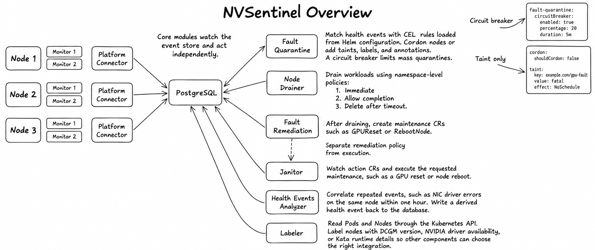

> This article introduces only the main components of NVSentinel. It does not cover the Preflight mechanism, which I will explain in a separate post.

## Why Do GPU Clusters Need NVSentinel?

Imagine a multi-node training job that suddenly stalls after running for several hours. NCCL timeouts start appearing in the logs, and GPU utilization drops. Yet Kubernetes still reports the nodes involved in the job as `Ready`.

Where is the problem? Has a GPU failed, or is something wrong with the communication links between nodes? Operators begin checking GPU status, system logs, and network information one node at a time, then correlate these clues with the training job's error timestamps. Even after identifying the affected node, several questions remain: Can it still accept new jobs? What should happen to the workloads already running on it? Does it need a GPU reset, a node reboot, or manual maintenance?

This is one of the challenges of operating GPU clusters: **node availability, hardware health, and a job's ability to run successfully are different states.** Kubernetes reporting a node as `Ready` does not prove that its GPUs, GPU memory, and InfiniBand interconnects are all healthy. In multi-node training, processes communicate and synchronize frequently, so a problem on a single node can leave the entire job waiting for a long time or cause it to fail.

GPU clusters typically already have some monitoring capabilities. DCGM provides GPU health signals, system logs record driver and device errors, and monitoring platforms display metrics and trigger alerts. But moving from detecting an anomaly to handling a failure still requires someone to determine which node is affected, which component is involved, how serious the problem is, and what action to take.

NVSentinel brings these health signals into a unified event-processing flow, enabling an automated workflow for detection, isolation, and recovery. Different monitoring components detect anomalies and describe them as structured health events. Downstream components then use their configuration to record events, isolate nodes, drain workloads, or initiate maintenance.

For operations teams, this means starting with continuous detection and event recording to understand cluster health, then gradually automating handling policies that have been validated. The following sections begin with the monitoring components and follow a health event through the system to explain how NVSentinel works.

## What Is NVSentinel, and What Can It Do?

NVSentinel is a health-monitoring and fault-handling system developed by NVIDIA for Kubernetes GPU clusters. It converts different health signals into a common event format and uses custom configuration to drive subsequent fault handling.

Its main capabilities fall into four groups, each answering a different question:

1. Health monitoring. How do we detect problems with GPUs, the system, and other infrastructure?
2. Fault isolation. How do we prevent new jobs from being scheduled onto a faulty node?
3. Workload handling. When a node needs maintenance, how do we gracefully stop the workloads already running on it?
4. Remediation and recovery. How do we trigger maintenance, repair the problem, and return the node to service?

Health monitoring is the foundational capability. The other three require enabling the appropriate components, configuring policies, and integrating with the deployment environment. The maintenance actions available depend on the actual deployment. Cloud providers need to configure this part based on their own operating scenarios and experience.

### Health Monitoring — Monitor + Platform Connector

This is NVSentinel's foundational capability. For a minimal initial deployment, I recommend enabling only this part first. It consists of the various Monitor components and a Platform Connector on each node. Once NVSentinel is enabled, monitors run as DaemonSets on GPU nodes to check hardware health and logs, while a Platform Connector receives the health results sent by those monitors.

When the Platform Connector receives a health event, it performs two operations. First, it updates the Kubernetes node's Conditions based on the event, making GPU or NIC health visible in the node's description. Second, it forwards the health event to a centralized database. **This database is important** because it is the single source of truth through which the components coordinate their work.

### Fault Isolation — Fault Quarantine

Once a monitor detects a fault, the first thing we need to do is prevent additional workloads from being scheduled onto the affected node. For example, when a monitor detects an XID 79 fault, it sends a health event to the Platform Connector, which forwards it to the database. The node no longer has its full complement of available GPUs, so workloads scheduled onto it may fail. We therefore need to isolate it promptly.

This is where Fault Quarantine comes in. Custom CEL expressions can trigger two kinds of actions, which can be used together. One adds taints, labels, or annotations to the node. The other automatically cordons the node when the configured conditions are met.

After cordoning the node, Fault Quarantine sends a change event to the database to indicate that the step is complete. It also provides a configurable circuit breaker to prevent a cluster-wide event from causing excessive node quarantines.

### Handling Workloads on Quarantined Nodes — Node Drainer

Once a node has been quarantined, the next step is to handle the workloads still running on it. We need to clear the node before proceeding with remediation. This is the purpose of Node Drainer.

Node Drainer watches change events in the database and begins eviction when it detects that cordoning is complete. It supports namespace-level or pod-level eviction policies: workloads can be evicted immediately, allowed to finish, or forcibly deleted after a specified timeout. We can choose a policy based on the workload. For training workloads, for example, we can use `DeleteAfterTimeout` to allow time for checkpoints to be saved.

### Planning Remediation — Fault Remediation

If you have glanced at the next section's title, you may have noticed that it is about actually executing remediation. That's right: the Fault Remediation component itself does not perform maintenance operations. Its main role is to watch the database for change events from Node Drainer concerning quarantined nodes.

Once the necessary conditions are met, it uses the `RecommendedAction` attached to the monitor's health event to create a corresponding CR (Custom Resource) representing the desired action. The CR records which issue it was created for and whether it has already been executed. This allows Fault Remediation to avoid creating duplicate action CRs.

NVSentinel currently includes four built-in CR types: `RebootNode` to reboot a node or VM, `TerminateNode` to terminate the instance associated with a node, `GPUReset` to reset a specified GPU, and `ExternalRemediationRequest` to hand maintenance over to an external system.

### Executing Remediation — Janitor

NVIDIA defines the Janitor component to execute the actual remediation operations. Janitor watches the cluster for CRs created by Fault Remediation. When a CR is created, it performs the operation mapped from the health event's `RecommendedAction`.

NVSentinel defines several `RecommendedAction` values, but Janitor natively supports only some maintenance operations.

| RecommendedAction | Possible CR Mapping | Native Janitor Support |
| --- | --- | --- |
| `NONE` | No CR created | Not needed |
| `COMPONENT_RESET` | `GPUReset` / `RebootNode` | ✅ |
| `RESTART_VM` | `RebootNode` | ✅ |
| `RESTART_BM` | `RebootNode` | ✅, depends on the execution backend |
| `REPLACE_VM` | `TerminateNode` | ✅, replacement requires an external system |
| `CONTACT_SUPPORT` | Custom ticket CR | Requires an external system |
| `RUN_FIELDDIAG` | Custom diagnostic CR | Requires an additional controller |
| `RUN_DCGMEUD` | Custom diagnostic CR | Requires an additional controller |
| `CUSTOM` | Any custom CR | Requires a corresponding controller |

Before executing an operation, Janitor pauses the dependent services required by that operation. For example, it ensures that DCGM on the target node is drained so that open GPU handles do not prevent a reset.

After remediation, Fault Quarantine uses the monitors' latest results to determine whether to uncordon the node. Post-Remediation Validation can also be used when more complex checks are needed. Finally, once the target node has returned to `Ready`, all paused dependencies resume, and Janitor marks the CR as complete.

That completes the workflow.

## Risks

There is a potential risk worth highlighting for distributed workloads. As the diagram shows, even a single failed GPU can interrupt an entire 32-GPU training job. Recovery must be coordinated across the whole distributed training job. NVSentinel cannot handle failures in the training software stack above the Kubernetes layer; that requires the fault-tolerance and recovery mechanisms of the distributed training system or orchestration framework itself.

## Overview

Finally, a few tips:

1. As the workflow above shows, the system coordinates its components through events in the database.
2. You can define your own NVSentinel Monitor or integrate an existing monitoring component by implementing the required communication protocol.
3. NVSentinel uses Node Conditions to indicate why a node is unhealthy. You can use Kubernetes `kube-state-metrics` metrics to configure monitoring and alerts.
4. Taints can help prevent additional workloads from being scheduled onto the node.
5. Fault Remediation is not limited to a fixed set of CR types; you can define your own.
6. `ExternalRemediationRequest` is the handoff point where NVSentinel transfers ownership to an external system. After completing its operation, that system must set `ExternalRemediationComplete=True` to notify NVSentinel that the work is done.
