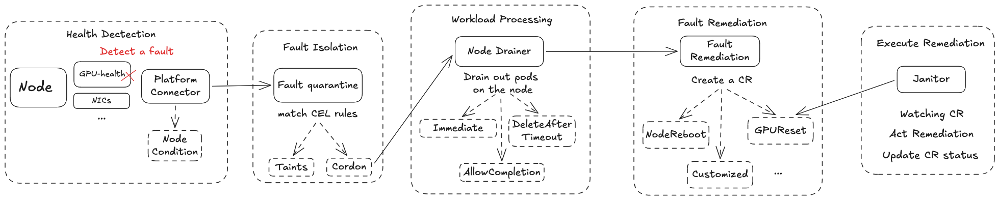
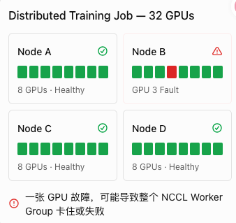
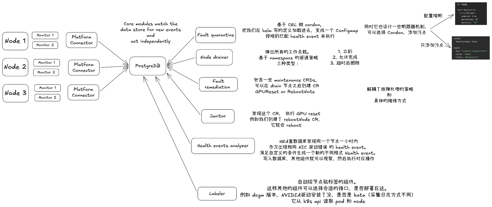

> 本文只提到了 NVSentinel 中主要的组件。此外，本文不包含 Preflight 机制，这部分我会在单独的博客中讲解。

## 为什么 GPU 集群需要 NVSentinel？

想象这么一个场景，一项运行了几个小时的多节点训练任务突然停住了。我们观察到日志中陆续出现 NCCL 超时，GPU 利用率开始下降，但从 Kubernetes 看，参与训练的节点仍然处于 `Ready` 状态。

问题出在哪里？到底是某张 GPU 出现了错误，还是节点之间的通信链路发生异常？运维人员开始逐个检查 GPU 状态、系统日志和网络信息，再把这些线索与训练任务的报错时间对齐。即使最终找到异常节点，接下来仍然有一连串问题需要回答：这个节点还能继续接收任务吗？正在运行的工作负载应该如何处理？需要重置 GPU、重启节点，还是交给人工维护？

这正是 GPU 集群运维中的一个难点：**节点可用和硬件健康以及任务能够正常运行是不同层面的状态。** Kubernetes 的 `Ready` 状态不能作为 GPU、显存和 IB 高速互联全部正常的证明。尤其在多节点训练中，各个进程需要频繁通信和同步，单个节点上的异常就可能让整个任务长时间等待，甚至最终失败。

通常来说 ，GPU 集群已经具备一定的监控能力。例如 DCGM 提供 GPU 健康信号，系统日志记录驱动与设备错误，监控平台负责展示指标和触发告警。但从“发现异常”到“妥善处理故障”，中间其实仍然需要有人完成判断：错误发生在哪个节点、影响什么组件、严重到什么程度，以及应该采取什么行动。

而 NVSentinel 的作用，就是将这些健康信号接入一套统一的事件处理流程，实现自动化的检测，隔离再进行恢复的完整工作流。不同的检测组件负责发现异常，通过结构化的健康事件描述故障，再由后续组件根据配置执行记录、隔离、工作负载排空或维护等操作。

对运维团队来说，这意味着可以先从持续检测和事件记录入手，建立对集群健康状况的认识，再逐步将经过验证的处理策略自动化。下文将从这些检测组件开始，沿着一条健康事件的处理路径，解释 NVSentinel 如何工作。

## NVSentinel是什么，它又能够做什么？

NVsentinel 是 Nvidia 开发的一个面向 Kubernetes GPU 集群的健康检测与故障处理的系统，它将各种健康信号转换为一种统一事件，并按照我们的自定义配置来驱动后续对于故障的处理。

它的主要能力可以被分为 4 组，分别对应了四个问题:

1. 健康检测。我们如何发现 GPU，系统还有其他基础设施的异常？
2. 故障隔离。我们如何避免新的任务继续被调度到故障节点上？
3. 工作负载处理。节点需要被维护时，我们的已有任务在该节点上如何被优雅的退出？
4. 修复与恢复。我们如何出发维护的动作，并且通过相应的流程修复并恢复使用。

在这里，对于第一项健康检测属于它的基础能力，而后面三类能力则是需要启用相应的组件来配置不同的策略和环境集成，具体的维护动作取决于实际的部署。这一部分需要云厂商基于自己的真实业务场景和经验进行配置。

### 健康检测 - Monitor + Platform Connector 

这一部分是 NVSentienl 的基础能力。如果我们想要最小化在集群中启用 NVSentinel，推荐在一开始只开启该能力。该能力在集群中对对应的组件是各种 Monitor 组件和 每个节点上对应的 Platform Connector 组件。在启用 NVSentinel 后，集群中的每个 GPU 节点上会以 DaemonSet 的形式部署各种 Monitor 来监控硬件设备和日志的健康，以及一个 Platform Connector 用来统一的接收 Monitors 发送的健康状态结果。在这里的 Platform Connector 接收到 Monitor 发送的 Health event 之后，它会进行两个操作：一个是基于收到的 Health Event 信息来更新 Kubernetes 节点的 Conditions 字段，即可以在节点的描述信息上看到该节点上 GPU 或者 NIC 的健康情况。另一个是将该 Health Event 信息转发到中心化的 Database 中。**这个 Database 很重要**，因为它是整个各个组件协同工作的 Single Source of Truth。

### 故障隔离 - Fault Quarantine

当我们的 Monitor 检测到故障发生之后，我们要做的第一件事情就是防止后续工作负载继续调度到问题节点之上。例如当我们的 Monitor 检测到例如 XID 79 (GPU has fallen off the) 故障之后，Monitor 进行响应，给 Platform Connector 发送了一条 health event 并将它转发到了 Database 中。很明显，这个时候该节点已经是一个显卡数量不完备的节点了, 接下来调度到该节点的 workload 很有可能失败，所以我们要做的事情就是赶紧隔离它。

这个时候就该我们的 Fault quarantine 组件登场了。它可以通过我们自定义的 CEL 表达式来触发两种操作，这两种操作可以同时存在。一个是给该节点加 Taints，Label 或者 Annotation。另一个是我们可以配置 Fault quarantine 在满足条件时自动 Cordon Node。

在 Fault quarantine 组件进行完 Cordon 操作之后，它会往 Database 发送一条  Change Event 来标识该步骤已完成。值得一提的是，为了防止 Fault quarantine 疯狂Cordon 节点，它还提供了一个断路器机制，可以配置以防止集群级别的事件导致大量的 quarantines。

### 处理被隔离节点上的工作负载 - Node Drainer

当节点被隔离，我们下一步需要做的就是处理节点上还存在的工作负载，因为我们需要确保节点干净才能进行后续的 Remediation 操作。而Node Drainer 组件就是为此而生的。

Node Drainer 会观察  Database 中的 Change Event，一旦检测到 Cordon 已经完成，它就会开始执行驱逐操作。此外，Node Drainer 可以配置 namespace 级别 或者 pod 级别的驱逐策略，可以做到立即驱逐，允许工作负载完成后驱逐或者是等待 workload 超出指定时间后强制删除。 这里我们可以基于实际的工作负载来进行选择，例如对应训练工作负载，我们就可以设置策略为 `DeleteAfterTimeout` 来确保 checkpoint 被保存。

### 故障修复 - Fault Remediation

如果你不小心下面一节的标题，可能会发现它叫做实际执行修复操作。哈哈没错，我们接下来想要讲的 Fault remediation 组件并不会实际执行任何的 maintenance 操作。它的作用主要是观察 Database 中来自 Node Drainer 的 隔离节点的 Change Event。一旦具备条件，它就会基于 Monitor 检测到告警时携带的 RecommendedAction 来创建对应的 CR (Custom Resource) 来标识期望执行的 Action。该 CR 包含了针对什么问题创建的，已经是否被执行过了。通过这种方式， Fault remediation 组件就可以避免重复创建 Action CR。NVSentinel 目前内置了 4 种 CR。 分别是用来重启节点/VM 的 `RebootNode` ，用来终止节点对应实例的 `TerminateNode` ，重置指定 GPU 的 `GPUReset`  以及用来移交外部系统进行维修的 `ExternalRemediationRequest` 。

### 实际执行修复操作 - Janitor

Nvidia 定义了 Janitor 组件来执行实际的 remediation 操作。 Janitor 会去监控集群中 Fault remediation 组件创建的 CR。一旦发现 CR 被创建，它就会根据 当时 Health Event 携带的 `RecommendedAction` 去映射执行对应的操作。

这里值得一提的是，NVSentinel 定义了多个 `RecommendedAction`，但 Janitor 实际只支持部分维护操作。

| RecommendedAction | 可映射的 CR | Janitor 原生执行能力 |
| --- | --- | --- |
| `NONE` | 不创建 | 不需要 |
| `COMPONENT_RESET` | `GPUReset` / `RebootNode` | ✅ |
| `RESTART_VM` | `RebootNode` | ✅ |
| `RESTART_BM` | `RebootNode` | ✅，依赖执行后端 |
| `REPLACE_VM` | `TerminateNode` | ✅，替换需外部系统 |
| `CONTACT_SUPPORT` | 自定义工单 CR | 需要外部系统 |
| `RUN_FIELDDIAG` | 自定义 Diagnostic CR | 需要额外 Controller |
| `RUN_DCGMEUD` | 自定义 Diagnostic CR | 需要额外 Controller |
| `CUSTOM` | 任意自定义 CR | 需要对应 Controller |

在 Janitor 执行对应的  operation 之前，它会先基于具体的 operation 去暂停依赖的服务，例如确保将目标节点的 DCGM 排空，以防止 GPU 检测到句柄仍然被占用而阻止 reset 操作。

当救治行为执行完毕之后，Fault Quarantine 会基于 Monitor 的最新检测结果来判断 Uncordon 节点，在必要时我们也可以 Post-Remediation Validation 来进行更加复杂的验证。最后，在等待目标节点恢复为 Ready 状态之后，所有被暂停的依赖也会恢复，Janitor 再标记 CR 为完成状态。

整个工作流程到此结束。

## 风险

对于分布式工作负载任务，这里有一个值得一提的潜在风险需要注意。如图所示，即使只有 1 张 GPU 坏掉，整个 32-GPU 的训练任务也可能被迫中断。整个 Distributed Training Job 需要协调恢复。从这里我们可以知道，NVSentinel 无法去处理 k8s 层级之上的训练软件堆栈的故障，所以这部分需要分布式训练系统或者编排框架本身的容错和恢复机制来实现。

## Overview

最后，给一些小 Tips：

1. 从正文介绍的工作流程可以知道，整个系统依靠 Database 中的 Event 来进行协同工作。
2. 我们可以定义自己的 NVSentinel Monitor 组件或者将现有的监控组件接入，你只需要实现指定的通讯规范。
3. NVSentinel 通过 Node Conditions 来标识为什么该节点坏了，我们可以依靠 k8s的 `kube-state-metrics` 指标来进行监控和告警的设置。
4. 我们可以通过 Taints 可以帮助我们阻止工作负载继续往该节点调度
5. Fault remediation 能创建的 CR 类型并不固定, 我们可以自定义 CR。
6. `ExternalRemediationRequest` 是 NVSentinel 将 ownership 交给外部系统的连接点。在外部系统执行完成操作之后，需要由它来设置 `ExternalRemediationComplete=True` 来通知 NVSentinel 操作已经完成。

